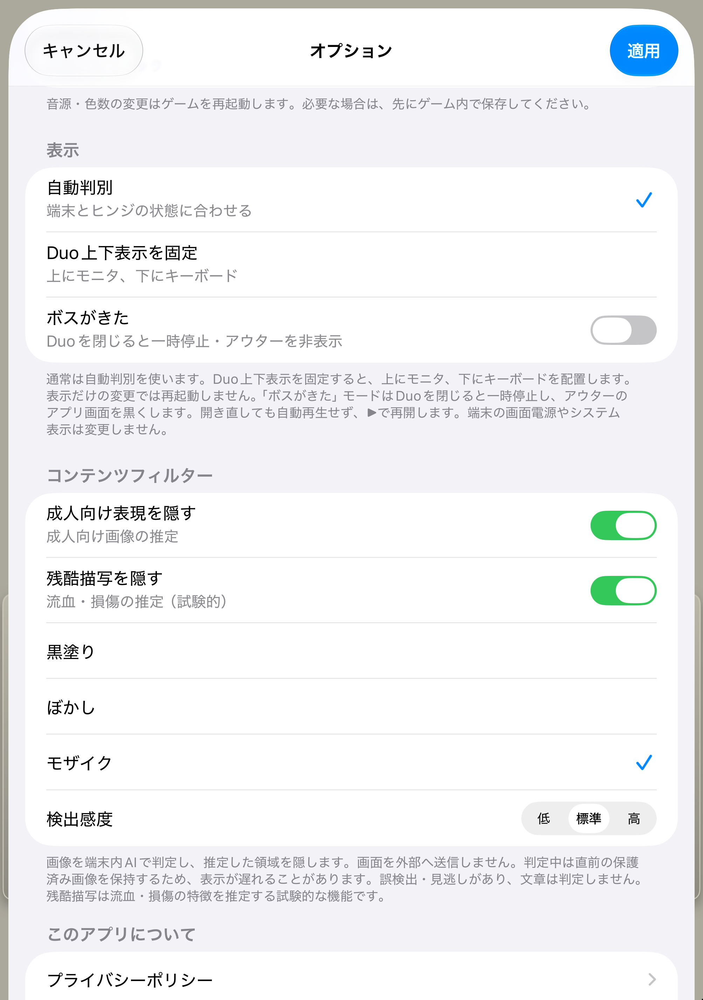

# 端末内コンテンツフィルター

RetroDOS Player iOS版の「オプション → コンテンツフィルター」から設定します。

1. 「成人向け表現を隠す」と「残酷描写を隠す」を必要に応じて個別にオンにします。
2. 「黒塗り」「ぼかし」「モザイク」から効果を選びます。
3. 必要なら検出感度を変更し、「適用」を押します。

初期状態は両方オフ・黒塗り・標準感度です。設定は端末内に保存され、再起動後も復元されます。フィルター設定だけの変更ではゲームを再起動しません。設定を適用するときは、オプションを閉じるアニメーションより前に表示画像を消し、未加工の画像が出ないようにします。



## 判定と描画

ゲームのフレームバッファをコピーし、Core MLで判定してから表示します。モデルはアプリへ同梱し、実行時のダウンロードや外部AIサービスは使いません。MetalとMetal Performance Shadersでマスクの合成・ぼかし・モザイクを実行します。BIOS不要のエミュレータコアと元ゲームデータには変更を加えません。

全体画像と4つの重なった部分画像を判定し、反応した部分画像の範囲を少し広げてマスクにします。**これは部分画像の分類から求める粗い領域推定です。物体の輪郭を正確に切り抜くセグメンテーションではありません。** 全体画像だけが反応して位置を絞れなかった場合は、画像全体へ効果を適用します。

推論は音声・エミュレーションを動かすメインスレッドとは別の直列キューで行います。処理中は最後に判定・加工した画像を保持し、初回は画像を表示しません。処理中の画像1枚と、置き換え可能な待機画像1枚に制限し、同一画像はバイト単位で比較して再判定を省きます。未判定の新画像を先に表示する経路は作りません。

ゲーム変更、ステート読込、色数による画面サイズ変更、フィルター設定変更では世代番号を更新し、古いジョブの結果を破棄します。通常画面、縦横回転、Duo、全画面は同じ表示経路を使います。モデルやMetalが利用できない場合も生画像へ戻さず、画像を消してエラーを表示します。フィルターを無効にすると読み込んだモデルを解放します。

## 同梱モデル

| 用途 | モデル・方式 | 配布条件 |
|---|---|---|
| 成人向け表現 | [Marqo/nsfw-image-detection-384](https://huggingface.co/Marqo/nsfw-image-detection-384)。384×384のViT-tiny、NSFW/SFW分類。FP16へ変換 | Apache-2.0 |
| 残酷描写 | [OpenAI CLIP ViT-B/32](https://github.com/openai/CLIP)の画像エンコーダーと、流血・損傷／通常場面の固定テキスト特徴を比較。224×224、重みをint8へ圧縮 | [timmの固定ミラー](https://huggingface.co/timm/vit_base_patch32_clip_224.openai)はApache-2.0、元のOpenAI CLIPはMIT |

**残酷描写は、専用のgore検出器を学習したものではなく、CLIPによる試験的な画像類似度推定です。** 武器を持っていることだけで隠す設定にはしていません。画像によっては暴力以外の内容にも反応します。

当初試した暴力・敏感画像のResNetモデルは、非残酷な背景や文章画面にも高いスコアを出したため採用しませんでした。採用したCLIP方式では、比較した7つの冒頭画像は全体画像のスコアが既定の閾値を下回りました。これは残酷描写に対する再現率の検証ではありません。

検出感度はスコアの閾値を低=.80、標準=.65、高=.45へ切り替えます。特にCLIPのスコアは、校正済みの発生確率ではありません。表示の遅延・発熱・電力消費はモデルと端末によって変わります。モデルを両方同梱するため、アプリのサイズは約100MB増えます。

出典、固定リビジョン、元重みと変換後ファイルのSHA-256は [models/manifest.json](../models/manifest.json)、固定語句は [models/harm-prompts.json](../models/harm-prompts.json) に記録しています。ライセンス全文と変更内容はアプリの「ライセンス」でも読めます。

## 限界

- ドット絵・ディザ・イラストで見逃しや誤検出があります。ドット絵の成人向け／残酷描写に対する再現率は未測定です。
- 台詞や文章の内容は判定しません。ゲームの音声も対象外です。
- 黒塗りは不透明ですが、ぼかし・モザイクは画像の色や形を一部残します。
- ステートやゲームの保存データは、エミュレーションを復元するための元の内容を保持します。フィルターは表示画像に適用します。
- 実機の推論速度、発熱、バッテリー消費と実コンテンツでの精度は、実機で別途検証が必要です。

## 検証

iPhone 17（iOS 27.0）とiPhone Duo（iOS 27.1）のシミュレーターで、モデル読み込み、実推論、Metalの3効果、領域外画素の保存、不透明な黒、ぼかしの細部低減、均一なモザイク、未判定画像の保留、古い世代の破棄、モデル読込失敗時の画像保護とエラー表示を検証しました。推論中もエミュレーションと音声キューが継続することも検証しました。結果は [検証記録](content-filter-verification.json) に保存しています。

C++のカテゴリ独立性・閾値・全体マスクへのフォールバック・不正出力・順序逆転の検証と、既存の音声・入力・保存・Duo配置の回帰テストを含みます。合成画像に固定マスクを与える加工テストと、実モデルの推論テストは区別しており、加工テストを検出精度の根拠にはしません。

```sh
IOS_BUILD_ROOT=build/content-filter ./build_ios.sh
IOS_BUILD_ROOT=build/content-filter ./tools/test_ios_simulator.sh DEVICE_UDID
IOS_BUILD_ROOT=build/content-filter ./tools/test_content_filter_simulator.sh DEVICE_UDID
```

デバッグ結果は `out/content-filter/DEVICE_UDID/` へ保存します。モデル変換時の最大出力差は、MarqoのFP16版で約.0032、CLIPのint8版で約.0049（無害なランダム画素／黒画像との比較）でした。精度の保証値ではありません。

モデルを再変換する場合は、別のPython環境へ `tools/content-model-requirements.txt` を入れ、次を実行します。元の公開safetensorsは固定リビジョンとSHA-256で検証し、任意のモデルリポジトリのPythonコードは実行しません。

```sh
python tools/rebuild_content_models.py --cache /tmp/retrodos-model-sources --output /tmp/retrodos-coreml-exports
```
