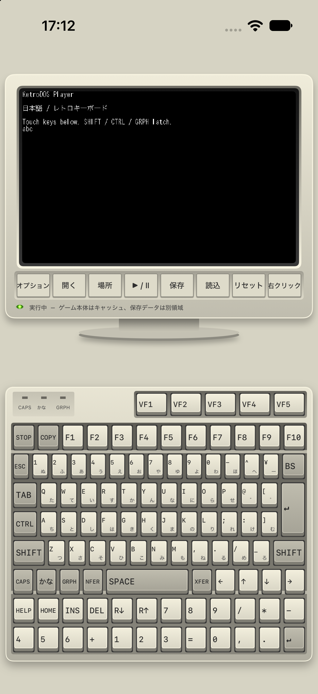
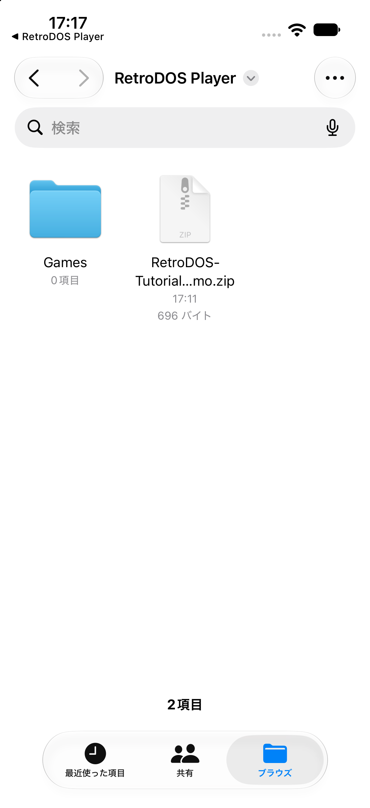
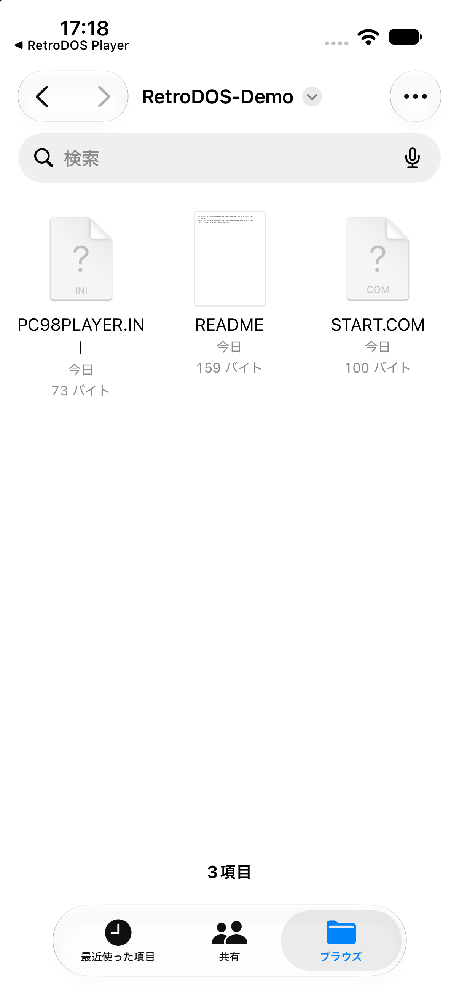
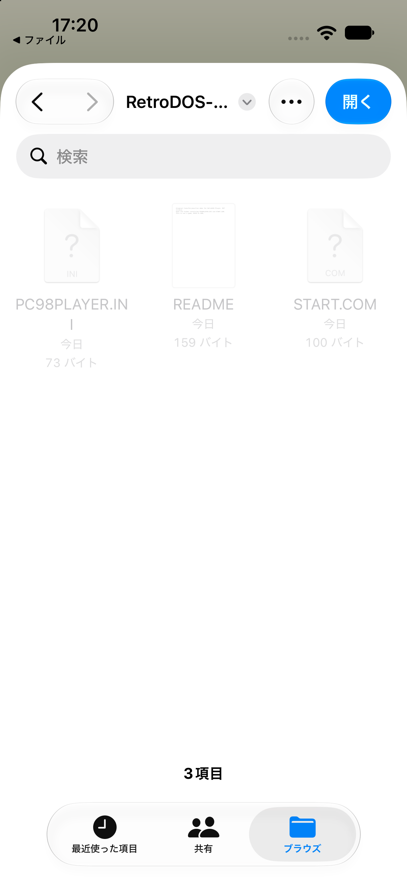
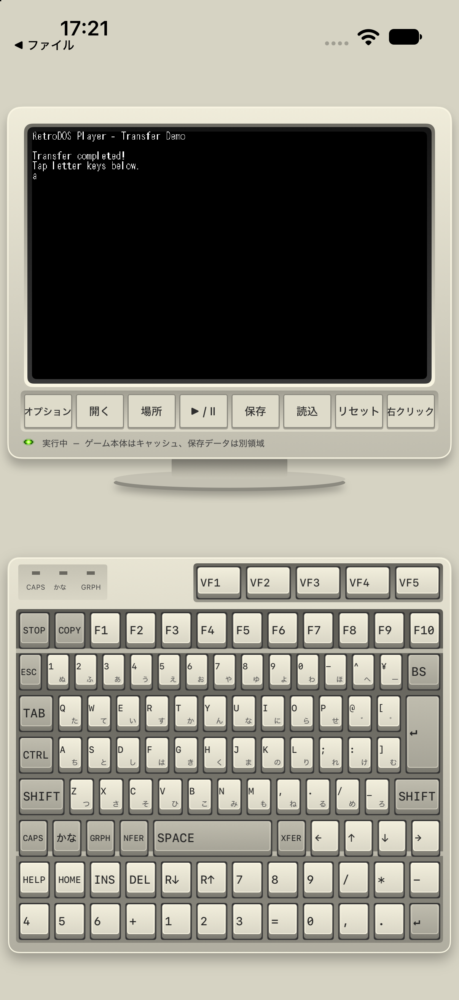
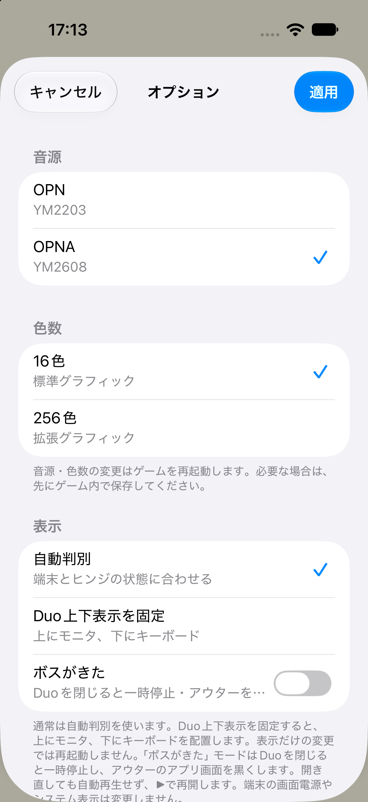

# RetroDOS Player はじめての導入ガイド（iPhone／iPad）

**パソコンのゲームフォルダをiPhoneへ転送し、アプリの「開く」で選べば始められます。NASは必要ありません。**

[App StoreからRetroDOS Playerを入手](https://apps.apple.com/jp/app/retrodos-player/id6826817332)

このガイドはApp Store版の操作を説明します。画像はiPhoneシミュレーターで撮影した操作例です。OSや端末によってボタンの位置・保存先の名前は少し異なります。

- [まずはデモで操作を試す](#demo)
- [1．パソコンでデータを用意する](#prepare)
- [2．iPhoneへ転送する](#transfer)：[Mac＋ケーブル](#mac-usb)／[Windows＋ケーブル](#windows-usb)／[Mac＋AirDrop](#airdrop)
- [3．iPhoneでZIPを展開する](#unzip)
- [4．RetroDOS Playerで起動する](#open)
- [設定と基本操作](#options)
- [うまくいかないとき](#trouble)
- [補足：クラウド・NASを使う場合](#network)

<a id="demo"></a>
## まずはデモで操作を試す

ゲームを転送する前に、アプリだけで入力と表示を試せます。

1. RetroDOS Playerを起動します。
2. モニター下の **「場所」→「オリジナルDOSデモ」** を選びます。
3. 画面下のキーボードで `A`、`B`、`C` などを押します。モニターに文字が出れば操作できています。



ゲーム本体は同梱していません。実際のゲームには、利用する権利のあるPC-98向けDOSソフトをご用意ください。BIOSやROMを別途入れる必要はありません。ソフトによって互換性は異なります。

<a id="prepare"></a>
## 1．パソコンでデータを用意する

**最初は、このガイド専用の小さな練習用ZIPを使うと確実です。** 第三者のゲームを含まない、文字入力だけのオリジナルデモです。

[転送練習用ZIPをダウンロード](https://raw.githubusercontent.com/koshikawa-masato/PC98PLAYER-iOS/main/docs/tutorial/RetroDOS-Tutorial-Demo.zip)

サンプルを使う場合、このZIPをそのまま次の手順でiPhoneへ送ってください。パソコンで展開・圧縮し直す必要はありません。

### 自分のゲームを使う場合

1. パソコン上でゲームの配布ファイルを展開します。`.lzh` や `.7z` などは、対応する展開ソフトで**先にパソコン側で展開**してください。拡張子だけを `.zip` に変更しても変換にはなりません。
2. **1作品につき1フォルダ**にまとめます。実行ファイルだけでなく、画像・音楽・設定などの関連ファイルと、必要なサブフォルダも入れたままにします。
3. そのフォルダをZIPに圧縮します。

例：

```text
RetroDOS-Demo/
├── PC98PLAYER.INI
├── START.COM
└── README.txt
```

MacではFinderでフォルダを右クリックして「圧縮」、Windows 11ではエクスプローラーでフォルダを右クリックして「圧縮先」などのメニューからZIPを選びます。メニュー名はOSのバージョンによって異なります。

**RetroDOS Playerが開くのは、展開後のゲームフォルダです。ZIPやLZHをアプリ内で直接実行する方式ではありません。** また、Windows用のEXEを選んでもPC-98用ゲームにはなりません。

<a id="transfer"></a>
## 2．iPhoneへ転送する

使っているパソコンに合わせて、次のどれか1つを選びます。

| パソコン | 方法 | 使うアプリ |
| --- | --- | --- |
| Mac | ケーブルで転送 | Finder |
| Windows | ケーブルで転送 | Appleデバイス |
| Mac | ワイヤレスで転送 | AirDrop |

iPhoneにRetroDOS Playerをインストールし、一度起動してから転送してください。

<a id="mac-usb"></a>
### Mac＋ケーブル：Finderで転送

1. データ通信できるUSBケーブルでMacとiPhoneを接続し、iPhoneのロックを解除します。
2. 接続確認が表示されたら、Mac側の「許可」やiPhone側の「信頼」を確認します。iPhoneのパスコードはiPhone上で入力します。
3. MacのFinderを開き、サイドバーの「場所」から自分のiPhoneを選びます。
4. **「ファイル」** タブを開き、アプリ一覧から **RetroDOS Player** を探します。
5. 手順1で用意した **ZIPをRetroDOS Playerの欄へドラッグ**し、コピーが終わるまで待ちます。
6. iPhone側の[ZIPを展開する手順](#unzip)へ進みます。

この操作は「ファイル共有」です。音楽・写真などを一括で同期する操作は不要です。Appleの[Finderでのファイル共有手順](https://support.apple.com/ja-jp/119585)も参照できます。

<a id="windows-usb"></a>
### Windows＋ケーブル：Appleデバイスで転送

1. WindowsにAppleの **「Appleデバイス（Apple Devices）」** アプリを用意します。
2. データ通信できるUSBケーブルでiPhoneを接続し、ロックを解除します。iPhoneに接続確認が出た場合は「信頼」を確認します。
3. Appleデバイスで自分のiPhoneを選び、**「ファイル」** を開きます。
4. アプリ一覧から **RetroDOS Player** を選びます。
5. **「ファイルを追加（Add File）」** から用意したZIPを選択し、「追加」を押します。
6. コピーが終わったら、iPhone側の[ZIPを展開する手順](#unzip)へ進みます。

画面名や接続条件はAppleの[Windowsからのファイル共有手順](https://support.apple.com/ja-jp/120402)を参照してください。

<a id="airdrop"></a>
### Mac＋AirDrop：ケーブルなしで転送

1. MacとiPhoneを近くに置き、両方のWi-FiとBluetoothをONにします。
2. iPhoneでAirDropを受信できる状態にします。
3. MacのFinderで用意したZIPを右クリックし、**「共有」→「AirDrop」→自分のiPhone** を選びます。
4. iPhoneで受信します。同じApple Accountの端末間では、自動的に受信される場合があります。
5. 保存先を選ぶ画面が出たら **「ファイルに保存」** を使い、「このiPhone内」などの分かる場所へ保存します。選択画面が出ない場合は、まず「ファイル」アプリの「最近使った項目」や「ダウンロード」を確認します。
6. [ZIPを展開する手順](#unzip)へ進みます。

受信できない場合は、[AppleのAirDropの案内](https://support.apple.com/ja-jp/119857)を確認するか、ケーブル転送を使ってください。

<a id="unzip"></a>
## 3．iPhoneでZIPを展開する

ここで開くのは、ホーム画面にある**青いフォルダの「ファイル」アプリ**です。RetroDOS Player内の「開く」とは別の画面です。

1. iPhoneで「ファイル」アプリを開きます。
2. **「ブラウズ」→「このiPhone内」→「RetroDOS Player」** を開きます。ケーブル転送したZIPは、このアプリのフォルダにあります。AirDropなどで別の場所へ保存した場合は、その保存先を開きます。
3. ZIPファイルをタップして展開します。
4. できたフォルダを開き、ゲームのファイルが見えることを確認します。練習用デモなら **`PC98PLAYER.INI` と `START.COM`** が入っています。

ZIPの名前や中身によっては、フォルダの中にもう1段フォルダができます。**実行ファイルがある階層まで開いて確認**してください。

Appleの[ZIPを開く手順](https://support.apple.com/ja-jp/102532)も参照できます。展開中・クラウドからの取得中は、完了してから次へ進みます。

ZIPをタップする前の「ファイル」アプリと、展開したフォルダの中身です。




<a id="open"></a>
## 4．RetroDOS Playerで起動する

1. RetroDOS Playerへ戻り、モニター下の **「開く」** を押します。
2. フォルダ選択画面で「ブラウズ」からZIPを展開した場所へ進みます。ケーブル転送なら **「このiPhone内」→「RetroDOS Player」** です。最初に空の「Games」が開いた場合は、戻るボタンで上の階層へ移動します。
3. **実行ファイルが入っている作品フォルダの中へ入り、右上の「開く」** を押します。練習用デモでは `PC98PLAYER.INI` と `START.COM` があるフォルダを選びます。ファイル単体やZIPは選びません。
4. データの読み込みが終わるまで待ちます。INIに起動ファイルが指定されていれば、そのまま起動します。
5. **「起動するプログラム」** が出た場合は、ゲームの説明書で指定された `.BAT`・`.COM`・`.EXE` を選びます。複数ある場合、インストーラーや設定用プログラムをゲーム本体と取り違えないようにしてください。
6. 練習用デモなら「Transfer completed!」と表示されます。キーを押して文字が出れば、転送から起動まで成功です。

左はアプリのフォルダ選択画面です。中のファイルが薄く表示されていても、右上の「開く」で**フォルダ全体**を選べます。右は練習用デモが起動し、`a` と入力できた画面です。




次回は **「場所」→登録したゲーム名** から開けます。起動ファイルを選び直す画面が出たら、前回と同じプログラムを選びます。

### PC98PLAYER.INIは必須？

通常のフォルダ形式では、INIがなくても起動候補を選べます。起動ファイルを指定したい場合だけ、パソコンの**プレーンテキストの編集アプリ**で `PC98PLAYER.INI` を作り、ゲームの実行ファイルと同じフォルダへ置きます。

```ini
[PC98PLAYER]
Start=DEPTH.EXE
```

`DEPTH.EXE` は例です。使うゲームのファイル名に置き換えてください。ファイル名が `PC98PLAYER.INI.txt` にならないようにします。既存INIがあるゲームは、まずその設定を使ってください。

<a id="options"></a>
## 設定と基本操作

最初から設定をすべて変える必要はありません。起動に成功してから、ゲームの説明書に合わせて調整します。

| 操作・設定 | 使い方 |
| --- | --- |
| 音源 | 「オプション」でOPN／OPNAを選び、「適用」。ゲームの対応音源に合わせます。 |
| 色数 | 同じ画面で16色／256色を選びます。すべてのゲームが256色になる設定ではありません。 |
| 表示 | 通常は「自動判別」。Duoで上下に固定したい場合は「Duo上下表示を固定」を選びます。 |
| 一時停止・再開 | モニター下の「▶︎ / Ⅱ」。別のアプリから戻った後も、必要ならここで再開します。 |
| リセット | ゲームを最初から起動し直します。未保存の進行は失われます。 |
| マウス | モニター上をドラッグして移動、1本指タップで左クリック、2本指タップで右クリック。 |
| 全画面 | モニターをダブルタップ。もう一度ダブルタップすると戻ります。 |
| 同時押し | 矢印＋スペースなど、複数の指で押せます。SHIFT／CTRL／GRPHは単独タップで保持、再タップで解除できます。 |
| 保存・読込 | アプリの状態保存は8スロット。ゲーム内のセーブ機能とは別です。 |

**マウス操作中心のゲームには全画面表示がおすすめです。** モニターをダブルタップするとゲーム画面が大きくなり、画面内のボタンやメニューを選びやすくなります。ドラッグでマウス移動、1本指タップで左クリック、2本指タップで右クリックします。キーボードが必要になったら、もう一度ダブルタップして通常表示へ戻してください。

**音源・色数を変えて「適用」するとゲームが再起動します。先にゲーム内で保存してください。**



### データはどこに保存される？

- 転送・展開したフォルダから、実行用のキャッシュを作ります。**転送元のフォルダとファイルは変更しません。**
- 初回は、ZIP・展開したゲーム・実行用キャッシュの分だけ空き容量が必要です。パソコン側の元データも残しておいてください。
- セーブと状態保存は、アプリ内の別領域に保持します。「場所 → ゲーム本体のキャッシュを消去」ではセーブを消しません。
- 再取得できるよう、iPhoneに展開した元フォルダも残しておきます。保存先のフォルダを移動した場合は「開く」で選び直してください。
- **アプリを削除すると、アプリ内のセーブ・状態保存も失われます。** 転送した元フォルダをパソコンへ戻すだけでは、別領域のセーブの取り出しにはなりません。不調時も、最初の対処としてアプリを削除しないでください。

<a id="trouble"></a>
## うまくいかないとき

| 症状 | 確認すること |
| --- | --- |
| パソコンにiPhoneが出ない | ロック解除・接続先への信頼・データ通信対応ケーブルを確認します。 |
| Finder／Appleデバイスにアプリが出ない | RetroDOS Playerのインストールと初回起動を確認し、パソコン側の表示を開き直します。 |
| 「開く」でZIPやEXEを選べない | 正常です。ZIPは先に「ファイル」アプリで展開し、アプリでは作品の**フォルダ**を選びます。 |
| 転送したファイルがない | 「最近使った項目」だけでなく、「ブラウズ」から保存先を開きます。空の「Games」に入っていたら上へ戻ります。 |
| LZHをタップしても展開できない | パソコンでLZHを展開し、ゲームフォルダをZIPにまとめ直して転送します。 |
| 「起動ファイルがありません」 | 正しいフォルダか、展開が完了しているか、実行ファイルやINIのStart指定があるかを確認します。 |
| 「Bad command or file name」 | 下のバージョン別の注意を確認します。INIのファイル名が実際のファイル名と一致しているかも確認します。 |
| 起動後に画像や音が出ない | 必要なデータを全部転送したか、ゲームの対応色数・音源かを確認します。アプリが一時停止していれば「▶︎ / Ⅱ」で再開します。 |
| それでも動かない | 対応が必要なソフトの可能性があります。バージョン・選んだフォルダ・実行ファイル名・症状を添えて[不具合を報告](https://github.com/koshikawa-masato/PC98PLAYER-iOS/issues)してください。認証情報やゲーム本体は投稿しないでください。 |

**0.2.0のサブフォルダ起動について：** `aa3558f/DEPTH.EXE` のような起動候補でエラーになる場合は、`DEPTH.EXE` が直接入っているフォルダを「開く」で選び直してください。この問題は0.2.1で修正しています。更新が利用できる場合はApp Storeでアップデートしてください。

<a id="network"></a>
## 補足：クラウド・NASを使う場合

iCloud DriveなどにZIPを置き、iPhoneの「ファイル」アプリでダウンロードして展開する方法も使えます。その場合も、最後はRetroDOS Playerの「開く」で作品フォルダを選びます。

NASを使う人は、**独立した「ファイル」アプリの「ブラウズ」→「…」→「サーバへ接続」** でSMB共有に接続してから、アプリの「開く」で選びます。アプリ内の選択画面に「編集」しかない場合は、ホーム画面の「ファイル」アプリへ戻って接続してください。

1. NASでSMB共有を有効にし、端末をNASに到達できるネットワークへ接続します。最初は同じ家庭内Wi-Fiで試してください。
2. 「ファイル」の「サーバへ接続」に `smb://NASの名前` または `smb://192.168.1.10` のように入力します。例のアドレスは、自分のNASのものに置き換えます。
3. 「登録ユーザ」でNASのユーザー名・パスワードを入力します。認証はOSの「ファイル」が扱います。
4. 共有内の作品フォルダが見えることを確認します。ZIPは先に展開し、必要なサブフォルダも残します。
5. RetroDOS Playerの「開く」→「ブラウズ」で接続したサーバを選び、作品フォルダへ進んで右上の「開く」を押します。初回コピーの完了を待ちます。

取得済みキャッシュがあればNASに接続せず起動できます。キャッシュが消えた場合は再取得が必要です。NAS側のデータを更新したときはキャッシュを消去して再取得します。端末内の保存済み変更ファイルは優先されます。

NASへのセーブの自動同期はありません。通常のiPhoneでは、選んだデータを端末キャッシュへ取得して実行します。

NASが表示されない場合は、まず「ファイル」アプリ単体で接続できるか確認します。SMB設定、IPアドレス、共有権限、ユーザー名、ゲストWi-Fiによる端末間通信の制限を見直してください。NASの実アドレスや認証情報を不具合報告へ投稿しないでください。各メーカーのNASでの実接続は未検証です。

---

[リポジトリのREADMEへ戻る](../../README.md)

撮影・手順確認：2026年11月5日。ZIPの展開・フォルダ選択・デモの起動と入力はiPhoneシミュレーターで確認しました。ケーブル転送とAirDropの説明はAppleの公式手順を基にしています。転送用ZIPの内容はオリジナルのDOSデモで、[MITライセンス](../../LICENSE)です。[生成スクリプト](make_sample.py)も公開しています。
